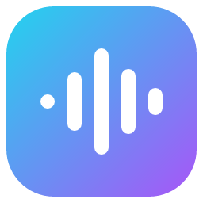
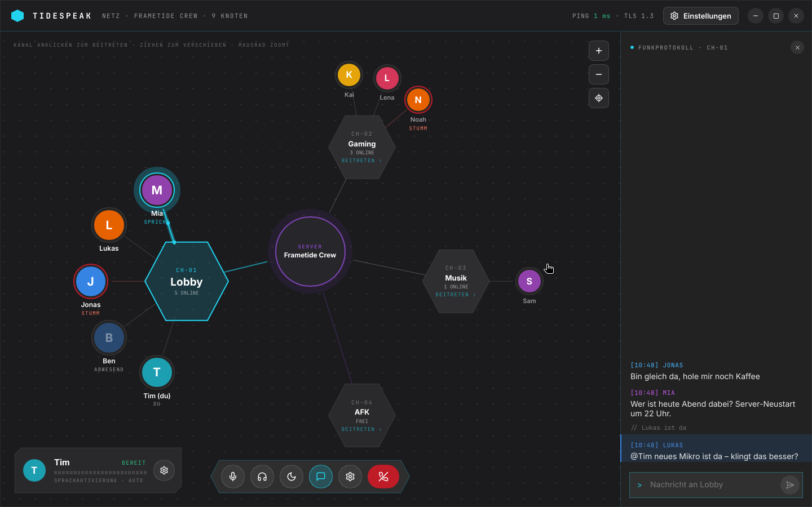
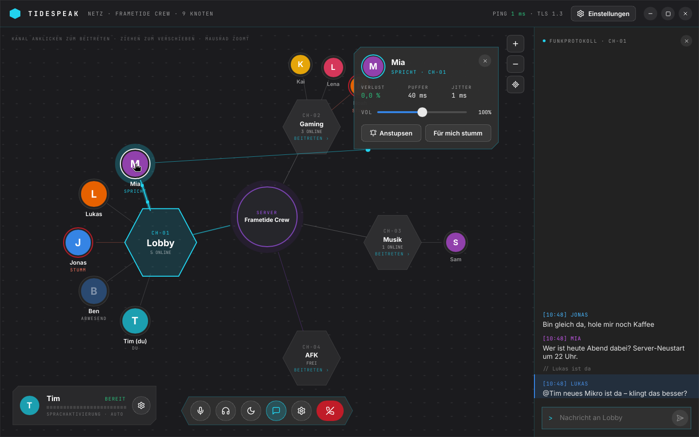
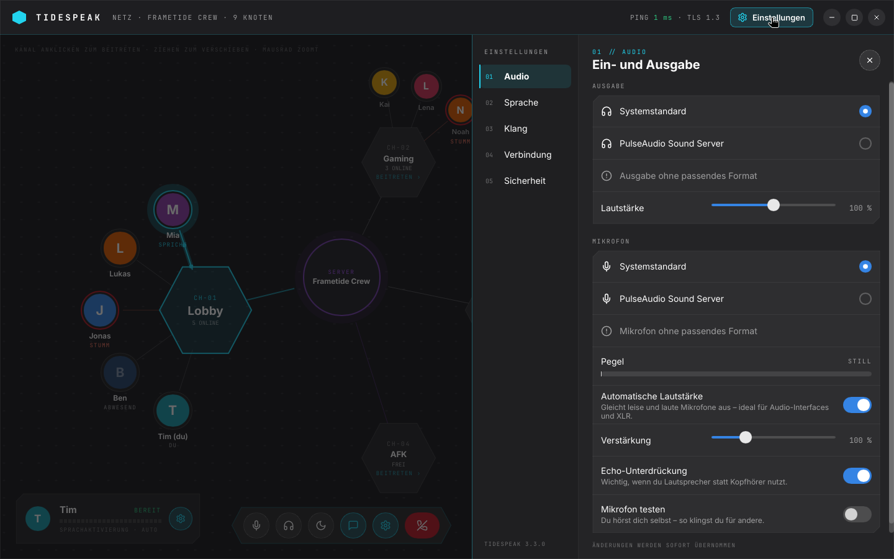
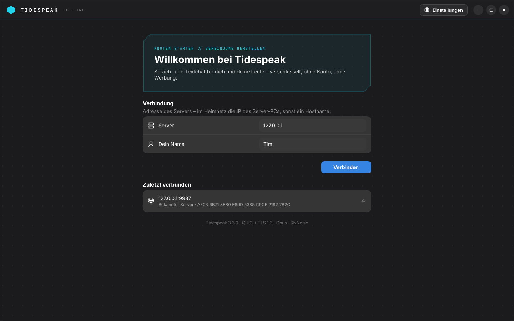

<div align="center">



# Tidespeak

**Lightweight, encrypted voice and text chat for Linux and Windows, styled after Frametide OS.**

No account, no ads, no tracking. Start a server, enter its address, start talking.

</div>



## The network view

Tidespeak 3.3 drops the usual sidebar-and-list layout. Your server is shown as a **network**: the server core sits in
the middle, every channel is a hexagon connected to it, and every person is a node attached to their channel. Your own
channel is the large one on the left, the others share the right-hand side, so you see at a glance who is where.

- **Talking is visible:** when someone speaks, their node glows teal, the ring grows with their voice and small data
  packets run along the line to the channel. Muted people get a red ring, away people fade out, a weak connection
  turns the line amber.
- **Join with one click** on any channel hexagon (`BEITRETEN ›`). Drag the background to pan, use the mouse wheel or
  the `+` / `−` buttons to zoom, and the target button to recenter.
- **Person card:** click someone to open a card with their live reception values (loss, buffer, jitter), a volume
  slider just for you, **Anstupsen** (poke) and **Für mich stumm** (mute for me).
- **Your own panel** (bottom left) shows your status, a live mic meter and your transmit mode, with a gear for the
  settings. The **control dock** in the middle holds mic, headphones, away, channel log, settings and leave.
- **Funkprotokoll** (channel log) on the right: the text chat of your channel in a terminal style, with history and
  highlighted `@mentions`. It can be hidden from the dock.
- **Settings as a drawer** from the right, reachable from the header, the dock and your own panel at any time, also
  before connecting. Categories: Audio, Sprache (transmit mode), Klang (sound), Verbindung (connection), Sicherheit
  (security). Changes apply immediately. `Esc` closes the drawer or the person card.
- Fits small windows: below a certain width your own panel shrinks to avatar and gear.

<table>
<tr>
<td width="50%"><p align="center"><sub>Person card</sub></p></td>
<td width="50%"><p align="center"><sub>Settings drawer</sub></p></td>
</tr>
<tr>
<td width="50%"><p align="center"><sub>Connect</sub></p></td>
<td width="50%"></td>
</tr>
</table>

## Features

- **Voice channels** like TeamSpeak, shown as a live network (see above).
- **Text chat per channel** with history, so people who join later see recent messages.
- **Three transmit modes:** voice activation (sensitivity automatic or manual), push-to-talk (F2 to F9, with a short
  release delay so the last syllable isn't cut), or always on.
- **Echo cancellation** (WebRTC AEC3): others don't hear themselves when you use speakers instead of headphones.
- **Noise suppression** (RNNoise) built in. Keyboard clicks, fans and background hiss stay out.
- **Automatic mic level:** quiet XLR mics and audio interfaces are brought up to a clear speaking level, loud ones are
  tamed. Tidespeak also detects which input of an interface actually has the mic on it.
- **Robust over the internet:** an adaptive jitter buffer per speaker, Opus error correction that gets stronger
  automatically when listeners report packet loss, and concealment for anything that still goes missing.
- **Volume per person,** remembered by name, and **mute for me** for a single person.
- **Away status, pokes and mentions:** set yourself away (moon), poke someone, and get a notice and a sound when
  someone writes `@YourName`.
- **Connection info:** ping in the header, plus incoming loss and how well your own voice arrives at the others.
- **Mute and deafen** with one click, plus quiet sounds when people join or leave.
- **Mic test**, device selection, input gain and output volume.

The interface is currently in German.

## Quick start

1. Download the package for your system from **Releases** and extract it.
2. Start the **server**: `tidespeak-server` (Windows: `tidespeak-server.exe`).
   It prints its address and its **fingerprint**. Allow UDP port **9987** in your firewall.
3. Start **Tidespeak**, enter the server address and your name, and click **Verbinden** (Connect).
4. On the first connection Tidespeak remembers the server's fingerprint. Compare it once with what the server prints.
   If it ever changes, the app warns you.

On Linux, `./install.sh` in the extracted folder adds Tidespeak to the app menu (no root needed).

Windows may show a SmartScreen warning the first time, because the programs are not signed.

### Server options

```
tidespeak-server --name "Our Crew" --channels "Lobby,Gaming,Music,AFK" --motd "Welcome!" --port 9987
```

The server key is stored in `tidespeak-data/` (change it with `--data`). Keep this folder. Without it the server gets
a new identity and every client shows a warning.

### Hosting at home

1. In your router, forward **UDP** port 9987 to the local IP of the PC running the server (the server prints it under
   "Im Netzwerk"). TCP is not needed. Give that PC a fixed local IP in the router.
2. Allow the server through the firewall (Windows asks on first start; on Linux e.g. `sudo ufw allow 9987/udp`).
3. Friends connect to your **public IP** (see e.g. https://ifconfig.me) or a DynDNS name such as `myname.duckdns.org`.
4. Test from outside your network, for example from a laptop on a phone hotspot. Many routers can't reach their own
   public IP from inside.

If your connection has no public IPv4 address (DS-Lite / CGNAT, common with cable and many fibre providers), port
forwarding has no effect. The server listens on IPv4 **and IPv6**, so friends with IPv6 can still reach you via your
IPv6 address (allow UDP 9987 for IPv6 in the router). Alternatives: Tailscale/ZeroTier, or a small rented server.

### Tips for good audio

- **Audio interface / XLR mic:** set the gain on the interface so that normal speech lights up the green LED, not
  just barely. Automatic mic level does the rest. Tidespeak picks the input the mic is plugged into by itself.
- **Use headphones,** so your speakers don't feed back into your mic.
- **Wired beats Wi-Fi.** Under Settings → Verbindung you can see the loss for both directions. Up to about 2 % is
  inaudible thanks to error correction.

## How it works

| | |
|---|---|
| **Language** | Rust: as fast as C, without memory bugs |
| **Transport** | QUIC (quinn) with TLS 1.3. Text goes over a reliable stream, voice over datagrams, so a lost packet never holds anything up. One UDP port for everything. |
| **Security** | TLS 1.3 (ring), a self-generated server certificate, and a fingerprint check like SSH (trust on first use) |
| **Audio** | Opus at 48 kHz, 20 ms packets, 32/64/96 kbit/s, in-band FEC whose strength follows the loss listeners report, loss concealment, an adaptive jitter buffer per speaker (40–240 ms), and a mixer with soft limiting |
| **Mic chain** | active-channel detection, band-limited (Kaiser-windowed sinc) resampling, 80 Hz high-pass, automatic gain, RNNoise, voice activation with hysteresis and 60 ms pre-roll so word beginnings aren't cut |
| **Noise filter** | nnnoiseless (RNNoise in Rust); its speech probability also drives voice activation, so typing alone doesn't open the mic |
| **Echo cancellation** | sonora (pure-Rust port of WebRTC's AEC3); in tests it removes 44 dB of echo and leaves your own voice almost untouched (-0.5 dB) |
| **Interface** | Slint: native, no browser engine, software rendering. The network layout is computed in Rust, Slint draws it with paths and handles zoom and panning |
| **Audio devices** | cpal: PipeWire/PulseAudio and ALSA on Linux, WASAPI on Windows |

**Lightweight:** the client uses about 25–35 MB of RAM and under 1 % of one CPU core while idle. While someone in your
channel is talking, it uses about 5 % of one core in total, mostly for redrawing the animated network view (the
animation is tied to the 80 ms UI tick instead of running at 60 fps, which halves that cost). Talking yourself costs about 4.6 % of one CPU core
for the whole mic chain (resampling, echo cancellation, noise filter, automatic gain, Opus), and each person you hear
adds about 0.15 %. In a test with 40 participants and five people talking at once, the server used about 7 MB of RAM
and roughly 15 % of one core. It never decodes Opus, it only forwards packets to everyone in the same channel.

**Measured improvements in 3.1** (simulation with real speech: XLR mic on input 1 of a stereo interface at 44.1 kHz,
keyboard typing, and a jittery internet line):

| | 3.0 | 3.1 |
|---|---|---|
| Speech transmitted, normal mic level | 85.5 % (syllables cut off) | 99.9 % |
| Speech transmitted, quiet mic | 0 % | 96.3 % |
| Level at the listener, normal mic | -45.6 dBFS (very quiet) | -29.3 dBFS |
| Resampling distortion 44.1 → 48 kHz | -21 dB (tinny) | -95 dB |
| Missing audio, typical Wi-Fi / cable line | 9.8 % | 2.3 % (most of it rebuilt by FEC) |
| Missing audio, bad line | 30 % | 5 % |

Run it yourself with `cargo test --release -p tidespeak --lib quality_report -- --ignored --nocapture` (needs a speech
recording, see the test for details).

**What is encrypted:** everything between the app and the server (text, voice, names). The server itself can read
and hear the content, just like with TeamSpeak or Discord, so it should run on a machine you trust.

**Known limits:**
- On Linux, push-to-talk only works while the Tidespeak window has focus, because Wayland doesn't allow global
  hotkeys without extra work. Voice activation works everywhere. On Windows, push-to-talk works system-wide.
- Server and clients must use the same protocol version. 3.3 only changes the interface, so 3.3 clients work with 3.2
  servers and the other way round. Clients older than 3.2 get a clear message.
- The Windows GUI hasn't been tested on real hardware yet. The Windows build and tests pass in CI.

## Building from source

You need Rust (stable) and CMake (for Opus).

```sh
# Linux: sudo apt install libasound2-dev libfontconfig-dev cmake
cargo build --release
# Output: target/release/tidespeak and target/release/tidespeak-server
```

On Windows, install Rust (MSVC) and CMake, then run the same command.

`tidespeak-bot` is a test tool that needs no audio hardware. It connects like a client, can "speak" a test tone,
send chat messages and report what it receives, which makes it useful for load tests.

## History

This repository started as **ASM-Speak**, a voice and text chat written entirely in x64 assembly for Windows. That
version is still available in the git history and as release
[v2.0](https://github.com/ChopstickGuy/tidespeak/releases/tag/v2.0).

## License

GPL-3.0-or-later. Fonts: Inter and JetBrains Mono (both SIL Open Font License). Icons: Lucide (ISC).
