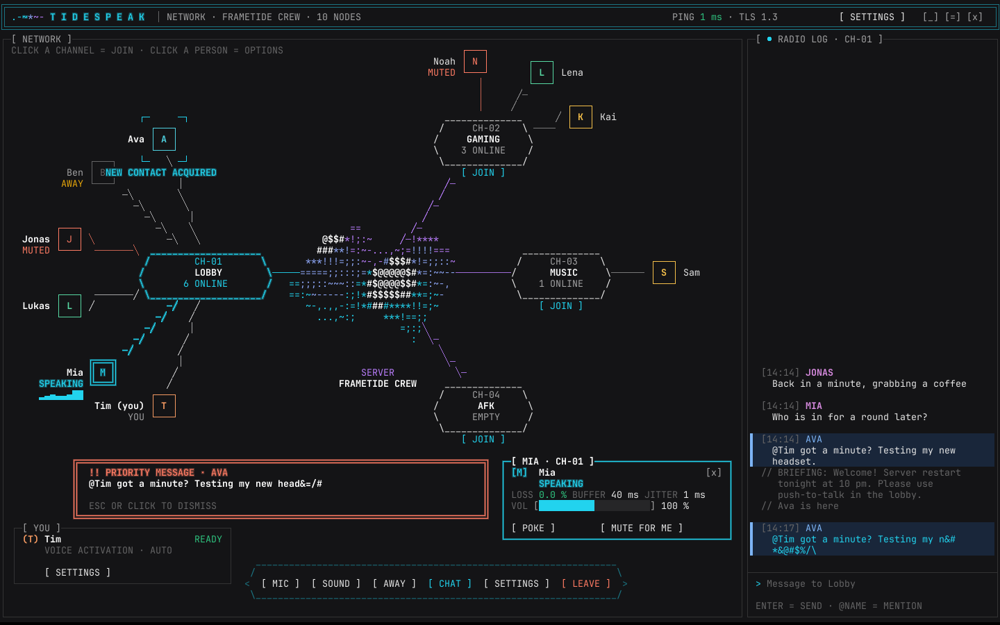
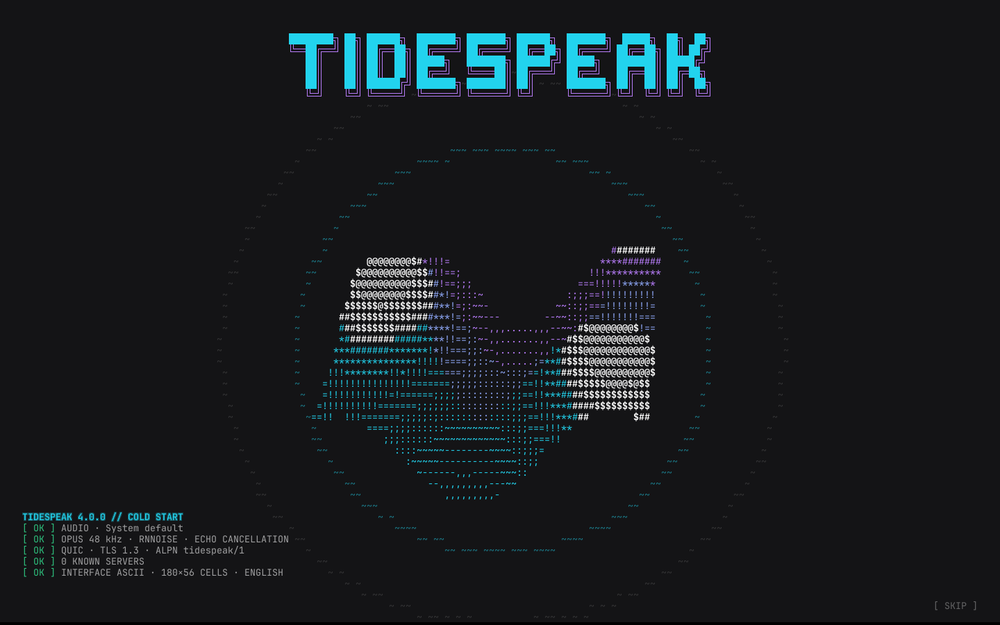
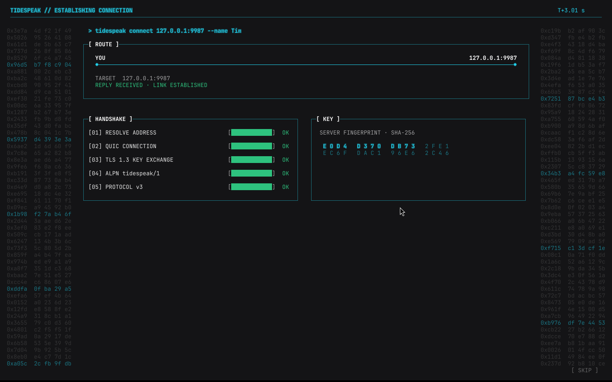
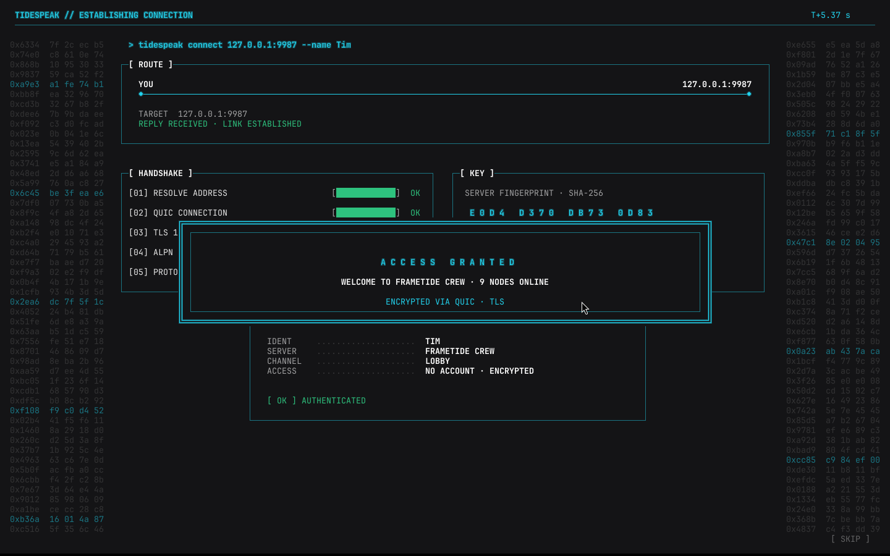
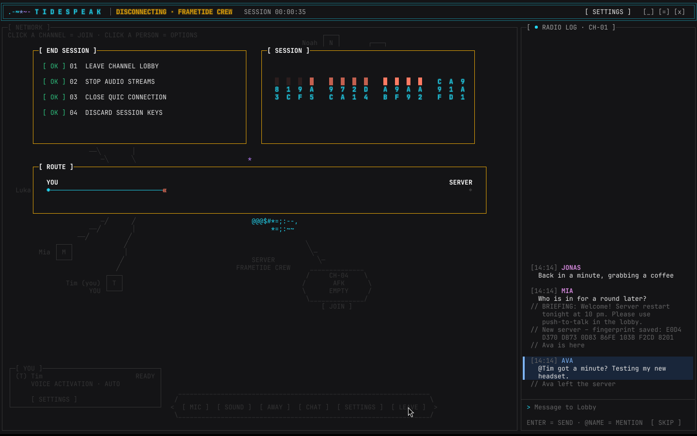

<div align="center">


# Tidespeak

**Encrypted voice and text chat for Linux and Windows – with an interface made entirely of characters.**

No account, no ads, no tracking. Start a server, enter its address, and watch the connection come up like in a spy movie.

</div>


## The ASCII interface

Tidespeak 4.0 draws its whole interface as a character grid – frames, hexagons, lines and a 3D wave made of
characters – in the Frametide colours (teal, purple, blue on near-black). It stays readable and calm in everyday use,
and turns into an action-movie terminal at the moments that matter: start, connect, switching channels, leaving.

### In the channel

- **The network:** your server is the core in the middle – a **3D wave of characters** that keeps rolling slowly. Every
  channel is a hexagon connected to it, every person a box connected to their channel. Your own channel is large on
  the left, the others share the right-hand side.
- **Who talks:** a speaker's box gets a glowing double frame `╔═══╗`, the line to the channel lights up, and a small
  **oscilloscope** `▁▃▅▇▅▃` runs next to the name while they speak. Muted people are red, away people fade out, a
  weak connection shows as `WEAK LINK`.
- **Join a channel** with one click on its hexagon. A wireframe prism flies to the centre, and a scan line rebuilds the
  network around your new channel.
- **Person card:** click someone for their live reception values (loss, buffer, jitter), a volume slider just for you,
  **Poke** (a packet `◆` flies to them and their box flashes) and **Mute for me**.
- **Radio log** on the right: the text chat of your channel. New messages arrive **encrypted-looking and decrypt**
  in front of you; your own messages type themselves out.
- **New contact acquired:** when someone joins your channel, crosshair corners close in on their box. When someone
  leaves, their box **dissolves into falling particles**.
- **Priority messages:** an `@YourName` mention or a poke opens a flashing red banner (Esc or click to dismiss), plays a
  sound and asks the taskbar for attention.
- **Briefing:** the server's welcome message types itself out in a briefing box when you arrive.
- **Dock and own panel:** mic, sound, away, chat, settings and leave in a hexagonal dock; your status, transmit mode
  and settings button bottom left.



### Sequences

| | |
|---|---|
| **Start** | A boot log types out (audio device, Opus, QUIC/TLS), the wave forms out of single points and rolls high, `TIDESPEAK` appears in big block letters, then the wave settles and the connect screen scans in. |
| **Connect** | The screen breaks into noise, packet dumps race down both sides, the command line types itself, a packet runs along the route to the server, five handshake bars fill up (address, QUIC, TLS 1.3, ALPN, protocol), the **real server fingerprint** locks in character by character, the sign-in types out – and `A C C E S S   G R A N T E D` flashes before the network scans in. The full sequence plays on the first visit of a server (when its fingerprint is saved); known servers get a 1.5-second version. It never waits artificially: it holds at the handshake until the server really answered, and a click or Esc skips it. |
| **Leave** | A red alert frame flashes, five steps are ticked off (leave channel, stop audio, close QUIC, discard session keys, clear session data), key material burns away `█▓░`, the route retracts back to you, `D I S C O N N E C T E D` – then a red edge wipes back to the connect screen. A lost connection plays the same sequence with the reason. |
| **Quit** | The network goes dark, the wave runs faster and flattens, the picture collapses like an old tube screen into a line and a dot, a tiny wave spins away – `SEE YOU SOON`. |

Everything shown in the sequences is what Tidespeak really does at that moment – it looks like a movie, but it is
not made up. Every animation can be switched off on its own in the settings.

<table>
<tr>
<td width="50%"><p align="center"><sub>Start</sub></p></td>
<td width="50%"><p align="center"><sub>Connect screen</sub></p></td>
</tr>
<tr>
<td width="50%"><p align="center"><sub>Connection sequence</sub></p></td>
<td width="50%"><p align="center"><sub>Access granted</sub></p></td>
</tr>
<tr>
<td width="50%"><p align="center"><sub>Settings drawer</sub></p></td>
<td width="50%"><p align="center"><sub>Leaving a server</sub></p></td>
</tr>
</table>

### Settings

A drawer slides in from the right (header, dock or own panel; Esc closes it) with six categories: **Audio**, **Voice**,
**Sound**, **Connection**, **Security** and **General**. Switches tick through `[·] [+] [*] [x]`, sliders glide to their
new value, and every change is applied at once and confirmed with a short typed message. In **Security** you can
confirm a server's fingerprint by hand – it decrypts, gets framed and stamped `[ VERIFIED ]`.

**Animations and sounds** (Settings → Sound): terminal sounds (quiet clicks and beeps), the moving server wave,
connection sequence, start and quit, join and leave, channel switch – each can be switched off.

### Language

Tidespeak is in **English** by default and switches to **German** automatically when the operating system is set to
German. You can also pick English or German by hand under Settings → General; it applies immediately.

## Features

- **Voice channels** like TeamSpeak, shown as a live network.
- **Text chat per channel** with history, so people who join later see recent messages.
- **Three transmit modes:** voice activation (sensitivity automatic or manual), push-to-talk (F2 to F9, with a short
  release delay so the last syllable isn't cut), or always on.
- **Echo cancellation** (WebRTC AEC3): others don't hear themselves when you use speakers instead of headphones.
- **Noise suppression** (RNNoise) built in. Keyboard clicks, fans and background hiss stay out.
- **Automatic mic level:** quiet XLR mics and audio interfaces are brought up to a clear speaking level, loud ones are
  tamed. Tidespeak also detects which input of an interface actually has the mic on it.
- **Robust over the internet:** an adaptive jitter buffer per speaker, Opus error correction that gets stronger
  automatically when listeners report packet loss, and concealment for anything that still goes missing.
- **Volume per person**, remembered by name, and **mute for me** for a single person.
- **Away status, pokes and mentions** with priority banners and sounds.
- **Trust on first use:** every server's fingerprint is saved on the first visit. If it ever changes, the connection is
  refused before anything is sent and a red alert explains what happened; only you can decide to trust the new key.
- **Connection info:** ping in the header, incoming loss and how well your own voice arrives at the others.

## Quick start

1. Download the package for your system from **Releases** and extract it.
2. Start the **server**: `tidespeak-server` (Windows: `tidespeak-server.exe`).
   It prints its address and its **fingerprint**. Allow UDP port **9987** in your firewall.
3. Start **Tidespeak**, enter the server address and your name, and click **» CONNECT**.
4. On the first connection Tidespeak remembers the server's fingerprint. Compare it once with what the server prints.
   If it ever changes, the app raises an alert.

On Linux, `./install.sh` in the extracted folder adds Tidespeak to the app menu (no root needed).

Windows may show a SmartScreen warning the first time, because the programs are not signed.

### Server options

```
tidespeak-server --name "Our Crew" --channels "Lobby,Gaming,Music,AFK" --motd "Welcome!" --port 9987
```

The server key is stored in `tidespeak-data/` (change it with `--data`). Keep this folder. Without it the server gets
a new identity and every client shows a warning.

### Hosting at home

1. In your router, forward **UDP** port 9987 to the local IP of the PC running the server (the server prints it under
   "Im Netzwerk"). TCP is not needed. Give that PC a fixed local IP in the router.
2. Allow the server through the firewall (Windows asks on first start; on Linux e.g. `sudo ufw allow 9987/udp`).
3. Friends connect to your **public IP** (see e.g. https://ifconfig.me) or a DynDNS name such as `myname.duckdns.org`.
4. Test from outside your network, for example from a laptop on a phone hotspot. Many routers can't reach their own
   public IP from inside.

If your connection has no public IPv4 address (DS-Lite / CGNAT, common with cable and many fibre providers), port
forwarding has no effect. The server listens on IPv4 **and IPv6**, so friends with IPv6 can still reach you via your
IPv6 address (allow UDP 9987 for IPv6 in the router). Alternatives: Tailscale/ZeroTier, or a small rented server.

### Tips for good audio

- **Audio interface / XLR mic:** set the gain on the interface so that normal speech lights up the green LED, not
  just barely. Automatic mic level does the rest. Tidespeak picks the input the mic is plugged into by itself.
- **Use headphones,** so your speakers don't feed back into your mic.
- **Wired beats Wi-Fi.** Under Settings → Connection you can see the loss for both directions. Up to about 2 % is
  inaudible thanks to error correction.

## How it works

| | |
|---|---|
| **Language** | Rust: as fast as C, without memory bugs |
| **Transport** | QUIC (quinn) with TLS 1.3. Text goes over a reliable stream, voice over datagrams, so a lost packet never holds anything up. One UDP port for everything. |
| **Security** | TLS 1.3 (ring), a self-generated server certificate, and a fingerprint check like SSH (trust on first use) |
| **Audio** | Opus at 48 kHz, 20 ms packets, 32/64/96 kbit/s, in-band FEC whose strength follows the loss listeners report, loss concealment, an adaptive jitter buffer per speaker (40–240 ms), and a mixer with soft limiting |
| **Mic chain** | active-channel detection, band-limited (Kaiser-windowed sinc) resampling, 80 Hz high-pass, automatic gain, RNNoise, voice activation with hysteresis and 60 ms pre-roll so word beginnings aren't cut |
| **Noise filter** | nnnoiseless (RNNoise in Rust); its speech probability also drives voice activation, so typing alone doesn't open the mic |
| **Echo cancellation** | sonora (pure-Rust port of WebRTC's AEC3); in tests it removes 44 dB of echo and leaves your own voice almost untouched (-0.5 dB) |
| **Interface** | A character grid drawn in Rust: glyphs from JetBrains Mono (rasterised with fontdue), frame, line and block characters drawn as exact shapes so they join seamlessly. Only changed cells are redrawn, and only changed tiles of the picture are handed to the window (Slint, software rendering, no browser engine). Real text fields from Slint sit exactly on the grid, so paste, selection and input methods work |
| **Language** | English by default, German when the system is German (sys-locale), switchable at runtime |
| **Audio devices** | cpal: PipeWire/PulseAudio and ALSA on Linux, WASAPI on Windows |

**Lightweight:** the client uses about 50 MB of RAM. With the rolling server wave and someone talking in your channel it
needs about 4 % of one CPU core in total – including receiving, decoding and mixing the voice. The everyday animations
(wave, oscilloscope) run at about 8 frames per second and only touch the part of the picture that changes; the
sequences run at 25–40 frames per second for a few seconds. Talking yourself costs about 4.6 % of one CPU core
for the whole mic chain (resampling, echo cancellation, noise filter, automatic gain, Opus), and each person you hear
adds about 0.15 %. In a test with 40 participants and five people talking at once, the server used about 7 MB of RAM
and roughly 15 % of one core. It never decodes Opus, it only forwards packets to everyone in the same channel.

**Measured improvements in 3.1** (simulation with real speech: XLR mic on input 1 of a stereo interface at 44.1 kHz,
keyboard typing, and a jittery internet line):

| | 3.0 | 3.1 |
|---|---|---|
| Speech transmitted, normal mic level | 85.5 % (syllables cut off) | 99.9 % |
| Speech transmitted, quiet mic | 0 % | 96.3 % |
| Level at the listener, normal mic | -45.6 dBFS (very quiet) | -29.3 dBFS |
| Resampling distortion 44.1 → 48 kHz | -21 dB (tinny) | -95 dB |
| Missing audio, typical Wi-Fi / cable line | 9.8 % | 2.3 % (most of it rebuilt by FEC) |
| Missing audio, bad line | 30 % | 5 % |

Run it yourself with `cargo test --release -p tidespeak --lib quality_report -- --ignored --nocapture` (needs a speech
recording, see the test for details).

**What is encrypted:** everything between the app and the server (text, voice, names). The server itself can read
and hear the content, just like with TeamSpeak or Discord, so it should run on a machine you trust.

**Known limits:**
- On Linux, push-to-talk only works while the Tidespeak window has focus, because Wayland doesn't allow global
  hotkeys without extra work. Voice activation works everywhere. On Windows, push-to-talk works system-wide.
- Server and clients must use the same protocol version. 4.0 only changes the client, so 4.0 clients work with 3.2 and
  3.3 servers and the other way round. Clients older than 3.2 get a clear message.
- The window needs at least 1360 × 720 pixels, so the network and the radio log fit side by side.
- Channel pan and zoom from 3.3 are gone: the network now always fits the window.
- The Windows GUI hasn't been tested on real hardware yet. The Windows build and tests pass in CI.

## Building from source

You need Rust (stable) and CMake (for Opus).

```sh
# Linux: sudo apt install libasound2-dev libfontconfig-dev cmake
cargo build --release
# Output: target/release/tidespeak and target/release/tidespeak-server
```

On Windows, install Rust (MSVC) and CMake, then run the same command.

`tidespeak-bot` is a test tool that needs no audio hardware. It connects like a client, can "speak" a test tone,
send chat messages and report what it receives, which makes it useful for load tests.

## History

- **4.0** – the ASCII interface: character-grid renderer, network view, sequences for start, connect, leave and quit,
  English/German.
- **3.3** – network view with Slint widgets. **3.2** – call view, echo cancellation, away and pokes.
  **3.1** – audio quality and internet robustness. **3.0** – rewrite in Rust.

This repository started as **ASM-Speak**, a voice and text chat written entirely in x64 assembly for Windows. That
version is still available in the git history and as release
[v2.0](https://github.com/ChopstickGuy/tidespeak/releases/tag/v2.0).

## License

GPL-3.0-or-later. Font: JetBrains Mono (SIL Open Font License).
