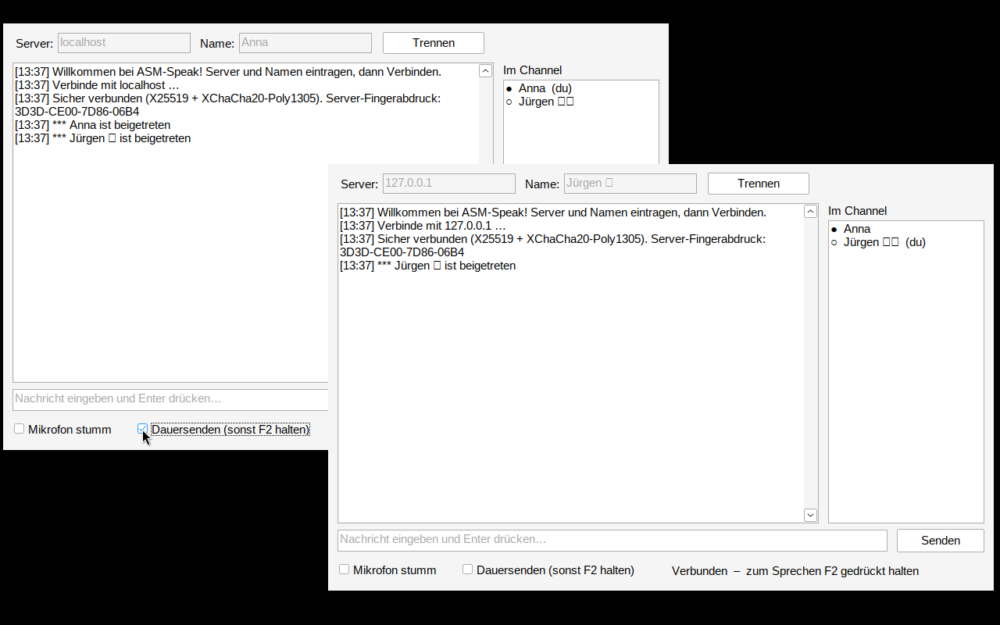

# ASM-Speak

Verschlüsselter Text- und Sprachchat (ähnlich TeamSpeak) in reinem **x64-Assembler** (NASM) für Windows – mit Win32-GUI, **Opus**-Sprachcodec und **libsodium**-Verschlüsselung. Kein Login: Server-Adresse und Namen eingeben, fertig.

## Schnellstart

1. Unter **Releases** die ZIP mit `server.exe`, `client.exe` und den DLLs herunterladen und entpacken.
2. `server.exe` starten (Firewall-Zugriff erlauben). Der Server zeigt seinen Fingerabdruck an.
3. `client.exe` starten → Server `127.0.0.1` (oder IP des Server-PCs) → **Verbinden**.
4. Den Fingerabdruck im Client mit dem im Server-Fenster vergleichen.
5. Schreiben mit Enter, sprechen mit **F2** gedrückt halten (oder „Dauersenden“).

Port **9987** TCP + UDP (fürs Internet beide im Router weiterleiten).

## Technik

| | |
|---|---|
| Sprache | Opus, 48 kHz mono, 20 ms, 32 kbit/s, Mischen mehrerer Sprecher (SSE2), Jitter-Puffer |
| Krypto | Ed25519-Server-Identität, X25519 pro Verbindung (Forward Secrecy), Text: XChaCha20-Poly1305 secretstream, Sprache: ChaCha20-Poly1305 + Replay-Schutz |
| Server | Konsole, Thread pro Client + UDP-Thread |
| Client | Win32-GUI, 5 Threads (GUI, Netz, UDP-Empfang/Mischer, Wiedergabe, Aufnahme) |

## Bauen

- **Windows:** NASM + MinGW-w64 (z. B. w64devkit), dann `build.bat`
- **Linux (Cross):** `nasm` + `mingw-w64` binutils, dann `./build.sh`

`libsodium-26.dll` / `libopus-0.dll` (MSYS2-Builds) und die Import-Bibliotheken in `lib/` liegen bei.

## Dateien

`server.asm` · `client.asm` · `proto.inc` (Protokoll + Krypto) · `common.inc` · `client.rc`/`app.manifest` · `LIESMICH.txt` (ausführliche Anleitung)
